# MSIC Member & Admin User Guide

**Mbale School of Clinical Officers Investment Club**

This guide explains how to use the club's web app: signing in, checking your savings and loans, requesting withdrawals and loans, acting as a guarantor and, for administrators, running the club's records.

> The screenshots use sample data. The names, amounts and references in them are made up.

**Contents**

- [Part 1: For all members](#part-1-for-all-members)
  - [Signing in](#signing-in)
  - [Membership types](#membership-types)
  - [Finding your way around](#finding-your-way-around)
  - [Your deposit accounts](#your-deposit-accounts)
  - [Requesting a withdrawal](#requesting-a-withdrawal)
  - [Loans](#loans)
  - [Loans with security (Founder Members)](#loans-with-security-founder-members)
  - [Being a guarantor](#being-a-guarantor)
  - [Surcharges](#surcharges)
  - [Your statement](#your-statement)
  - [Loan Insights (Founder Members)](#loan-insights-founder-members)
  - [Emails you will receive](#emails-you-will-receive)
- [Part 2: For administrators](#part-2-for-administrators)
  - [The two-approval rule](#the-two-approval-rule)
  - [Dashboard](#dashboard)
  - [Members](#members)
  - [Recording contributions](#recording-contributions)
  - [Correcting or reversing a transaction](#correcting-or-reversing-a-transaction)
  - [Approving withdrawals](#approving-withdrawals)
  - [Proposing and approving loans](#proposing-and-approving-loans)
  - [Deciding waivers for loans with security](#deciding-waivers-for-loans-with-security)
  - [Recording loan repayments](#recording-loan-repayments)
  - [Surcharges (admin)](#surcharges-admin)
  - [Reports and the audit log](#reports-and-the-audit-log)
  - [Loan Insights (admin)](#loan-insights-admin)
  - [Loan fund entries](#loan-fund-entries)
  - [Investments](#investments)
  - [Asset register](#asset-register)
- [Frequently asked questions](#frequently-asked-questions)

---

## Part 1: For all members

### Signing in

You sign in with the email address the club has registered for you. There is no password.

1. Open the club's app link.
2. If you are already signed in to Google, the app shows the account it found and asks **"Is this your registered club email?"**
   - Click **Yes, continue** if it is.
   - Click **Use a different email** if it is not.
3. Otherwise, enter your registered email address and click **Send code**.
4. Check your email for a 6-digit code. Enter it and click **Verify & sign in**. The code expires after **10 minutes**.

> **Didn't get the code?** Check your spam folder, or click **resend code**.
> **"Not Registered"?** The email you entered isn't on the club register, or your account is inactive. Contact the treasurer.

**The first time you sign in**, the app shows the club's **Terms of Use**. Administrators also see the **Administrator Confidentiality and Conduct Agreement**, which covers keeping member information confidential and never changing records outside the proper steps. Read them, tick the box under each, and click **Accept and continue**. You can't use the app until you accept. If you click **Decline and sign out**, nothing is recorded against you except the decline, and you can sign in and accept later.

If the club changes the terms, or you become an administrator, you are asked to accept the new version at your next sign-in. To read the terms again at any time, choose **Terms of use** in the menu.

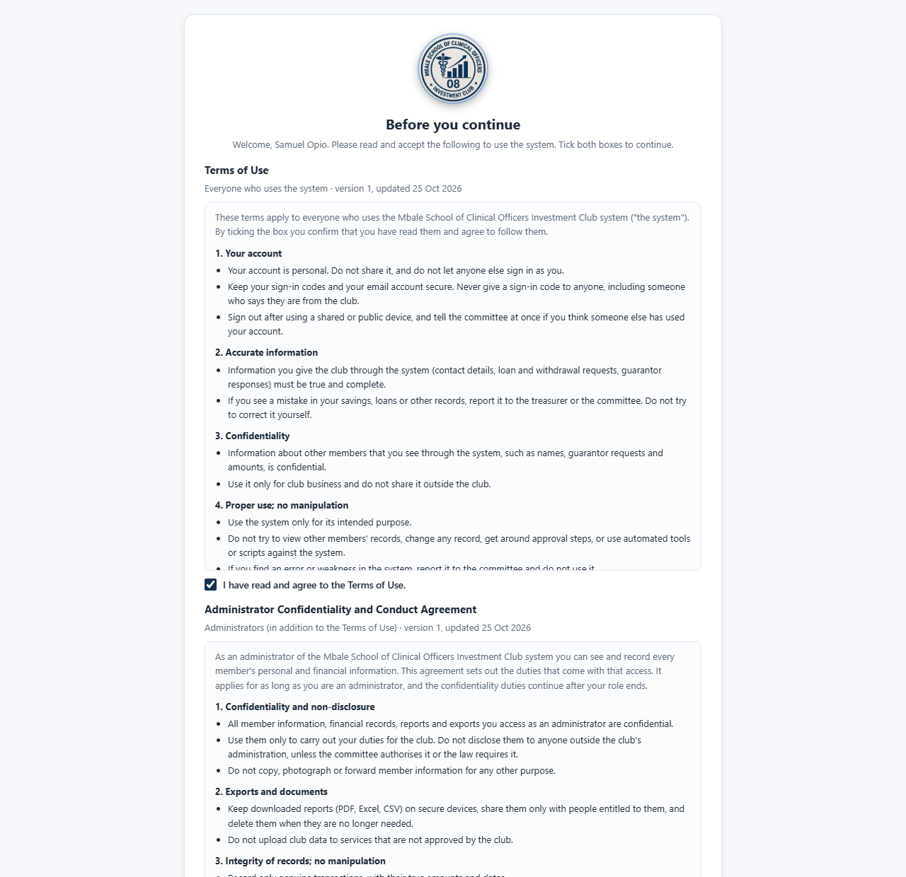

To sign out, click **Sign out** at the top right. **Dark mode** next to it switches the colour scheme.

### Membership types

Every member has one membership type. It decides what you can do in the app:

| | Founder Member | Delegate Member | Non-Member |
|---|:-:|:-:|:-:|
| Savings / deposit accounts | ✓ | ✓ | – |
| Withdraw from Principal, Operations, Welfare | ✓ | ✓ | – |
| Member loan (10%, minimum 2 months) | ✓ | ✓ | – |
| Soft Loan (1–4 weeks) | – | – | ✓ |
| Act as a guarantor | ✓ | – | – |
| See Loan Insights (club totals, read-only) | ✓ | – | – |

Your membership type is separate from your **role**. Admin is a role, held by some members.

If your membership type has not been set, ask an admin to set it before you request a loan.

### Finding your way around

- **On a computer**, the menu runs down the left side. Click **Collapse menu** to make it narrow.
- **On a phone**, the menu is the bar along the bottom. Tap **More** to see every section.

Your sections are **My account**, **My loans**, **My savings**, **My surcharges** and **My statement**. Founder Members and admins also see a **Club** group with **Loan insights**. Admins also see an **Admin** group (see [Part 2](#part-2-for-administrators)).

The cards at the top of **My account** show your savings balance, any loan outstanding and any unpaid surcharges. Further down are your loans, your three deposit accounts, your withdrawal requests and your savings history.

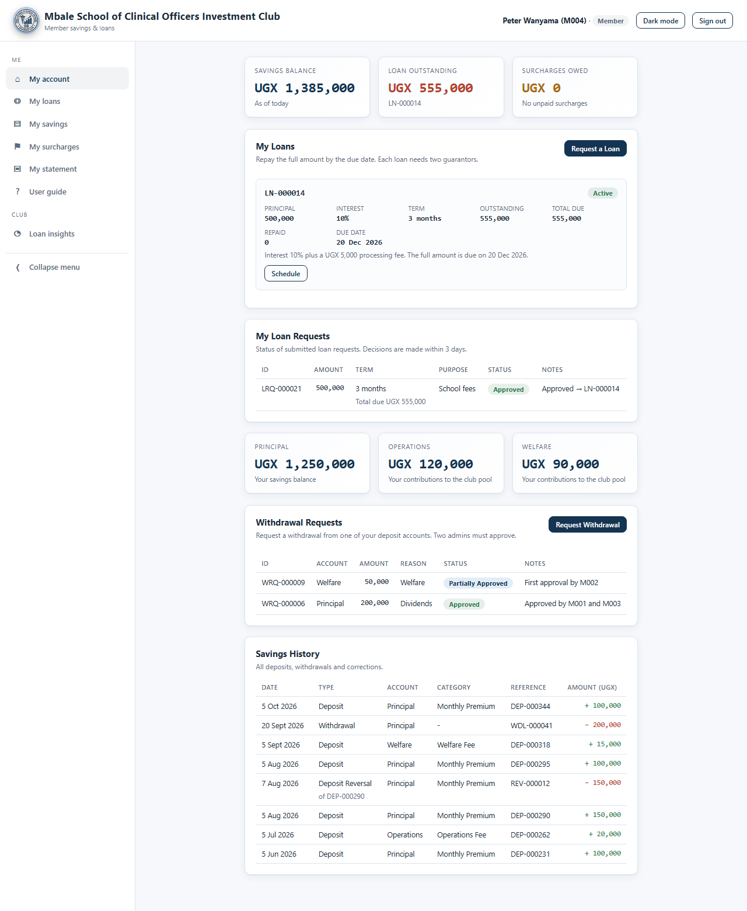

### Your deposit accounts

Your contributions are held in three separate accounts:

| Account | What it is | Who it belongs to |
|---|---|---|
| **Principal** | Your individual savings | You. Only you can withdraw your own Principal. |
| **Operations** | Contributions to the club's operations | The club, as a shared pool |
| **Welfare** | Contributions to the club's welfare fund | The club, as a shared pool |

Under **My savings** you will see:

- **Principal**: your savings balance.
- **Operations** and **Welfare**: how much *you* have contributed to each pool.
- **Savings History**: every deposit, withdrawal and correction on your account, with its date, account, category and reference.

Only **Principal** counts as your savings for loans. This affects how much you can borrow and whether you can act as a guarantor.

> **About corrections.** If an admin corrects or cancels a transaction, the original entry stays in your history. A **Deposit Reversal** or **Withdrawal Reversal** line appears beside it, marked with the reference it reverses. You are emailed whenever this happens.

### Requesting a withdrawal

Founder and Delegate Members can request withdrawals. Non-Members cannot.

1. Go to **My savings** and click **Request Withdrawal**.
2. In **Withdraw from**, choose **Principal**, **Operations** or **Welfare**. The form shows how much you can withdraw from that account.
3. Enter the **Amount**.
4. Choose a **Reason**: Exit from MSIC, Dividends, Welfare, Operations or Others. If you choose **Others**, type an explanation.
5. Click **Submit Request**.

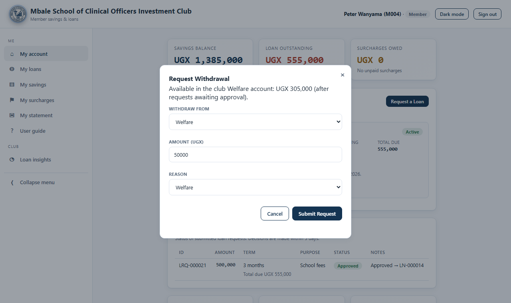

**How much can I withdraw?**

- **Principal**: up to your own Principal balance.
- **Operations / Welfare**: up to what the club currently holds in that account. It doesn't matter how much you personally contributed. You can request a Welfare withdrawal even if you have never paid into Welfare.
- Requests still awaiting approval are set aside first, so the amount shown is what is actually still available.

**What happens next?** Two different admins must approve your request. You are emailed after the first approval, and again when the money is released or if the request is rejected. Track progress in the **Withdrawal Requests** table under **My savings**:

| Status | Meaning |
|---|---|
| Pending | Waiting for the first admin approval |
| Partially Approved | One admin has approved; waiting for a second, different admin |
| Approved | Both admins approved; the amount has been taken from the account |
| Rejected | Not approved. The reason is shown under **Notes** |

### Loans

Click **Request a Loan** under **My loans**. The form shows the loan type that applies to you, and the total you will repay before you submit.

#### Member loans (Founder and Delegate Members)

- **Interest:** 10% of the amount borrowed.
- **Processing fee:** UGX 5,000.
- **Term:** at least 2 months. The full amount is due on the due date.
- **Limit:** up to 50% of your Principal savings. Admins can approve more with a recorded reason.
- **You must have been saving for at least 12 months**, counted from the date you joined the club (or your first Principal deposit, if that is earlier).

#### Soft Loans (Non-Members)

| Term | Interest |
|---|---|
| 1 week | 5% |
| 2 weeks | 10% |
| 3 weeks | 15% |
| 1 month (4 weeks) | 15% |

- **Processing fee:** UGX 10,000.
- The full amount is due on the due date.

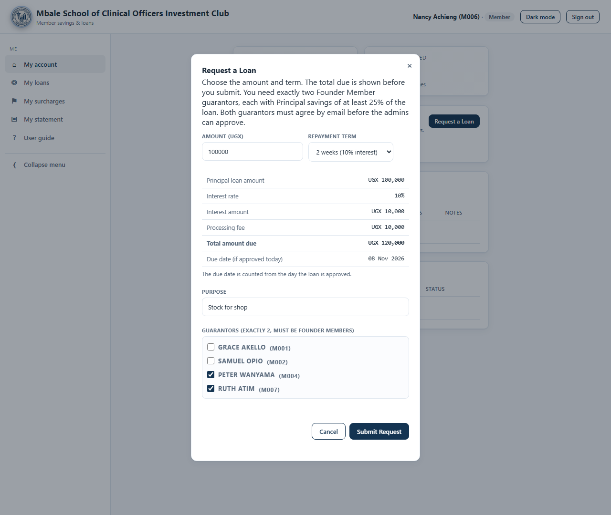

#### Rules for every loan

- You need **exactly 2 guarantors**, whatever your membership type. They must be **Founder Members**, and each needs Principal savings of at least **25% of the loan**.
- Both guarantors must **agree by email first**. Only then can the admins approve: two different admins must approve, and the loan is issued at the second approval.
- You can't take a new loan while you have one running.
- You can't take a loan while you are guaranteeing someone else's running loan, unless an admin proposes the loan for you with a recorded override reason.
- The committee aims to decide within **3 days**.
- The **due date is counted from the day the loan is approved**, not the day you applied.

**Example: Soft Loan of UGX 100,000 for 2 weeks**

| | UGX |
|---|---:|
| Loan amount | 100,000 |
| Interest (10%) | 10,000 |
| Processing fee | 10,000 |
| **Total to repay** | **120,000** |

#### Loans with security (Founder Members)

The constitution sets two savings coverage requirements: your loan must be within your cap (50% of your Principal savings), and each guarantor needs Principal savings of at least 25% of the loan. When you fill in **Request a Loan**, the form shows whether these are met. If one is not, a Founder Member can offer an asset as security and ask the committee to waive that requirement:

1. In **Request a Loan**, enter the amount and term and tick your two guarantors. The **Savings coverage** box shows which requirement is not met.
2. Click **Request for a Loan with Security**.
3. Choose the **Type of security** (Land Title, Car Logbook, Equipment, or Others; for Others, say what it is), and enter its **estimated value**, a **description**, the **ownership details** and **why the waiver should be granted**. You can add links to scanned documents (for example in Google Drive), one per line.
4. Click **Submit for Waiver Approval**.

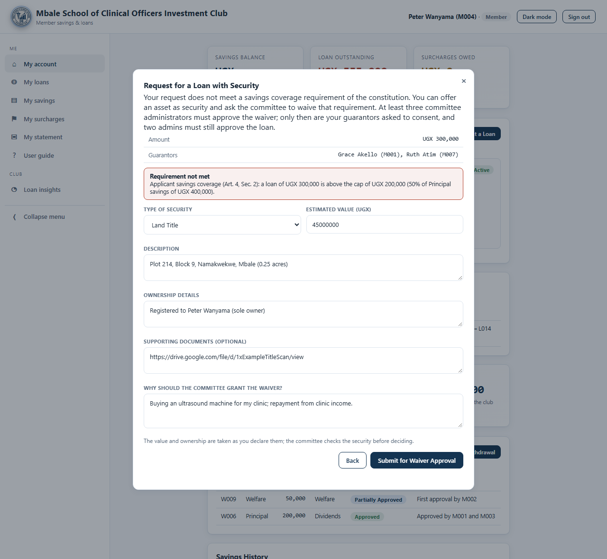

What happens next:

- The request shows as **Pending Waiver Approval**. At least **three committee administrators** (the Chairperson and two Finance Committee members) must approve the waiver. You are emailed when it is submitted, at each approval, and when it is approved or rejected. A rejection always comes with the reason.
- **Your guarantors are asked to consent only after the waiver is approved.** Then the loan follows the usual steps: both guarantors agree, then two different admins approve and the loan is issued.
- The waiver covers only the requirement that was not met. Every other rule still applies: the 12-month saving period, one loan at a time, exactly two Founder Member guarantors who agree, interest, fees and the due date.
- The value and ownership you give are taken as declared; the committee checks the security before deciding.

#### Repayment, reminders and late payment

You will receive emails:

- **3 days before** the due date;
- **on** the due date;
- if the loan is still unpaid **the day after** the due date, a **10% surcharge** on the loan plus interest is added automatically, and you are told;
- after that, a daily reminder until the loan is cleared, for up to **2 weeks**.

Pay the treasurer, who records your repayment. Your loan card under **My loans** shows the outstanding balance, due date and repayment schedule (click **Schedule**).

### Being a guarantor

Only Founder Members can be guarantors. When someone names you, you receive an email titled **"Please respond to guarantor request"** with **Approve** and **Decline** buttons.

1. Click **Approve** or **Decline** in the email.
2. A confirmation page opens. Nothing is recorded until you confirm.
3. To approve, click **Yes, approve**.
4. To decline, type your **reason** (required) and click **Yes, decline**.

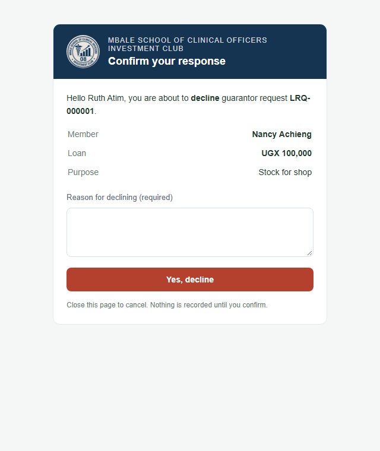

The applicant is told your answer. If you decline, the admins are told too, and the loan cannot go ahead with you as a guarantor.

**While you are guaranteeing a loan that is still running:**

- you can't guarantee anyone else;
- you can't take your own loan unless an admin approves an override;
- you are emailed a **Guarantor notice** whenever the borrower makes a repayment, pays or is charged a surcharge or fine, falls overdue, has a repayment reversed, and when the loan is fully cleared. Each notice shows the amount, the date and the remaining balance. The notices are for your information only: no money is paid to you. They stop once the loan is cleared.

### Surcharges

**My surcharges** lists any surcharges issued to you, with the reason and whether they are **Unpaid** or **Paid**. Settle unpaid surcharges with the treasurer.

### Your statement

Under **My statement**, click **Open PDF** to view your statement, or **Download PDF** to save it. It shows your balances in each account, all savings transactions, loans, surcharges and requests. You also receive a short summary by email on the 1st of every month.

### Loan Insights (Founder Members)

Founder Members can see how the club's loan fund is doing. Click **Loan insights** under **Club** in the menu.

This view is **read-only** and shows **club totals only**. No member's name, loan or balance appears in it, so other members can't see your loan here. Delegate Members and Non-Members don't have this section.

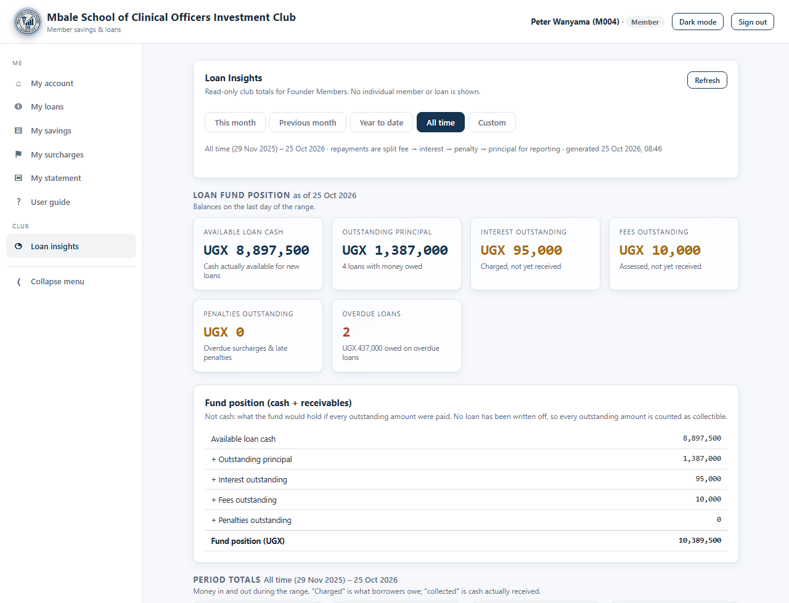

Choose a period at the top: **This month**, **Previous month**, **Year to date**, **All time** or **Custom** (pick the dates and click **Apply**). Everything on the page updates to that period.

| Section | What it shows |
|---|---|
| **Loan fund position** | Balances on the **last day** of the period. **Available loan cash** is the money the club actually has for new loans. The other cards show what borrowers still owe. |
| **Fund position** | Cash plus everything still owed to the fund. It is **not** cash: it is what the fund would hold if every loan were paid in full. |
| **Period totals** | Money in and out **during** the period: loans paid out, and principal, interest, processing fees and penalties received. |
| **Loan fund cash movements** | How the cash moved from the start of the period to the end. |
| **Borrowers** | How many people borrowed in the period, and how many were borrowing for the first time. |
| **Trends by month** | Charts for each month. Point at a bar or line to see its value, or open **Show the monthly figures as a table**. |

**Good to know**

- **Where the loan fund's money comes from.** Its capital is the members' **Principal** savings. Principal deposits add to it and Principal withdrawals take from it. Operations and Welfare are not part of the loan fund.
- **"Charged" vs "collected".** *Charged* is what borrowers owe; *collected* is cash actually received. Unpaid interest and fees are never shown as collected.
- **How a repayment is counted.** Each repayment pays off the processing fee first, then interest, then any penalty, and then the amount borrowed.
- **Penalties** are the 10% overdue surcharge and the older late penalty. They are shown on their own line, separate from interest.
- **Clients served.** A member who took two loans in the period counts as one client; the number of loans is shown separately.

### Emails you will receive

| When | Email |
|---|---|
| An admin records a deposit or withdrawal | Deposit / Withdrawal Confirmation |
| A transaction on your account is corrected or reversed | Contribution Corrected / Savings Transaction Reversed |
| Your withdrawal or loan request gets its first approval, is approved or is rejected | Request update |
| You are named as a guarantor | Guarantor request, with Approve / Decline buttons; a reminder each morning until you respond |
| A guarantor responds to your loan request | Guarantor response |
| A loan you guarantee is repaid, charged, overdue or cleared | Guarantor notice |
| Your loan is due soon, due today or overdue | Loan reminders |
| The 1st of each month | Monthly Statement |

---

## Part 2: For administrators

Admins see an **Admin** group in the menu: **Dashboard**, **Members**, **Loans**, **Savings**, **Surcharges**, **Reports**, **Investments** and **Audit log**, plus **Loan insights** under **Club**. A number on **Loans**, **Savings**, **Loan insights** or **Investments** shows how many items are waiting for approval.

### The two-approval rule

Every loan, every withdrawal request, every [loan fund entry](#loan-fund-entries) and every [investment transaction](#investments) needs **two approvals from two different admins**. The app enforces this:

- You **can't approve a request you started**, including a loan you proposed for a member.
- You **can't approve a request for your own account**, such as your own loan or withdrawal.
- You **can't give both approvals**.
- A **rejected** request can't be approved later.

When one of these rules applies, the app shows a note instead of the **Approve** button. Admins are emailed when a request has its first approval and needs a second.

**Daily reminders.** Every morning, each admin with something waiting gets **one email**, *"Waiting for your action"*, listing every loan request, withdrawal, loan fund entry, investment transaction, asset verification and loan-with-security waiver they can act on, and how long each has waited. An item is included once it has waited 12 hours, and you are reminded only about items the rules allow you to approve: not your own requests, not ones you started, and not ones you already approved. Reminders continue each day until the item is approved or rejected.

### Dashboard

The dashboard shows member, savings, loan and surcharge totals, this month's activity and overdue loans.

The **Deposit Accounts** panel has a tab for each account: **Principal**, **Operations** and **Welfare**. Each tab shows:

- **Total contributions**: every deposit ever recorded in that account, less any reversed deposits. The figure under it is this month's contributions.
- **Withdrawals** and **Current balance**.
- A table of each member's contributions and withdrawals. For Principal, the last column is each member's balance. For Operations and Welfare, it is **Net**: the member's contributions less their withdrawals. A negative Net is normal, because members withdraw from the shared pool.

Figures are recalculated from the transaction records every time the dashboard loads, so they always match the ledger.

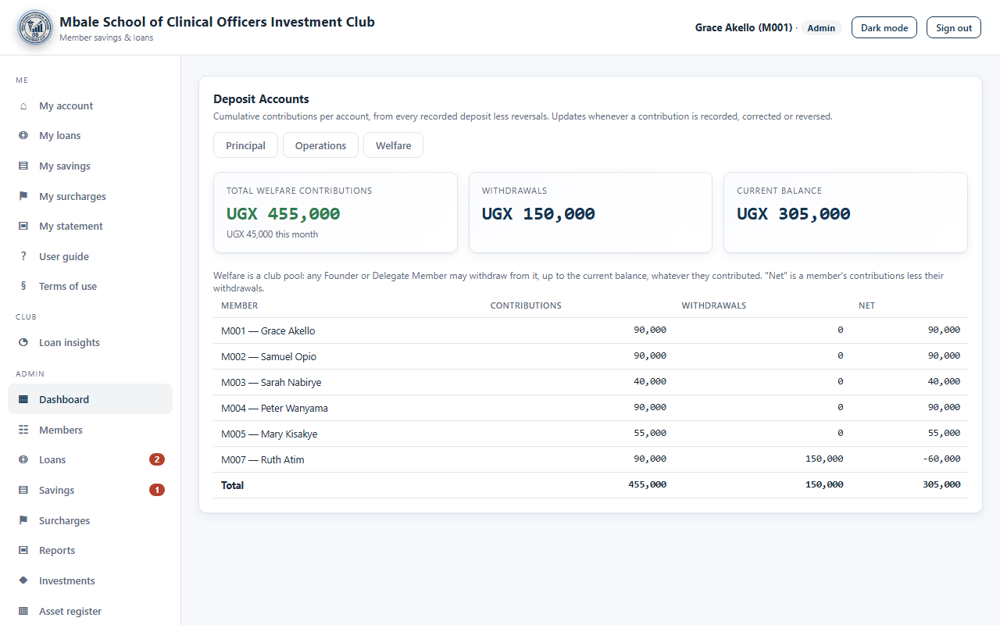

### Members

**Members** lists every member with their role, membership type, status and total savings.

- **+ Add Member**: enter the name, the email they will sign in with, their phone number (optional; a Ugandan number such as 0712 345 678, or any other country's number with its country code, such as +254 712 345 678; it is saved as +256…), role (Member or Admin), membership type and **date joined the club**. Member numbers (MSIC-0001, MSIC-0002, …) are assigned automatically. A number never changes, even if the member's membership type or date joined does.
- **Edit**: change a member's role, membership type, status (Active / Inactive), date joined or **committee role** (Finance Committee or Chairperson, for deciding waivers on loans with security). Inactive members cannot sign in. Leaving the date box empty keeps the current date.

> **Members who joined before the app was in use.** Set each one's **Date joined** to the date they really joined. The 12-month saving rule for loans counts from that date. Otherwise a long-standing member would be treated as new and refused a loan. The date can't be in the future, and every change is kept in the audit log.

The buttons **Record Savings**, **Propose Loan** and **Issue Surcharge** are also on this page.

### Recording contributions

1. Under **Members**, click **Record Savings**.
2. Choose the **Member** and the **Type** (Deposit or Withdrawal).
3. Enter the **Amount** and the **Date of transaction**. It can't be a future date.
4. Choose the **Deposit account**: Principal, Operations or Welfare.
5. For a deposit, choose the **Payment category**. Only categories that belong to the chosen account are offered:

   | Account | Payment categories |
   |---|---|
   | Principal | Membership Fee, Annual Subscription Fee, Monthly Premium, Surcharge |
   | Operations | Operations Fee |
   | Welfare | Welfare Fee |

   For **Surcharge**, also choose the surcharge reason.
6. Add a **Reference / description** if you have one, such as a bank slip number.
7. Click **Save**. The member is emailed, and the entry is recorded in the audit log with your name.

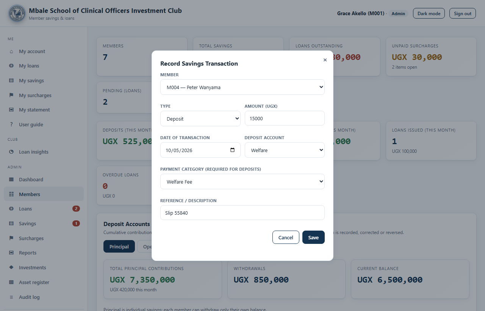

Non-Members can't have deposits. A withdrawal can't take Principal below zero, or take Operations or Welfare below what the club holds.

> A withdrawal recorded here takes effect immediately, with no second approval. For member-initiated withdrawals, use the request and approval process described below.

### Correcting or reversing a transaction

Recorded transactions are never edited or deleted. A correction adds new entries, so the full history is kept.

1. Go to **Savings → Savings Transactions**. Set the filters you need (member, type, account, category or dates) and click **Apply filters**.

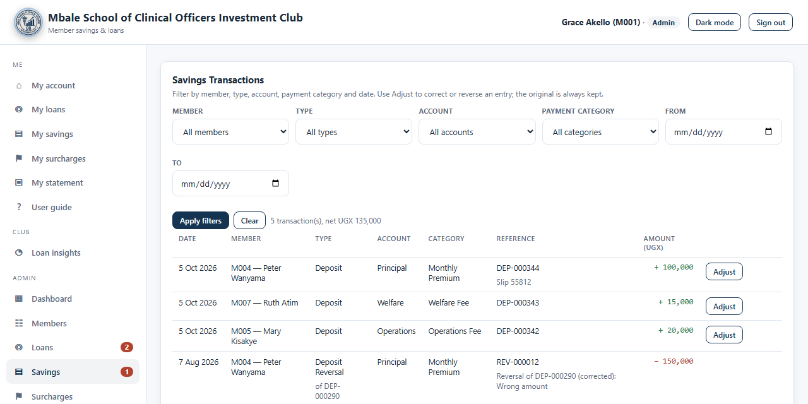
2. Click **Adjust** next to the transaction.
3. Choose an action:
   - **Correct this deposit**: change the amount, date, account or category. The original is reversed and the corrected deposit is recorded as a new entry.
   - **Reverse (cancel) this transaction**: cancels a deposit or a withdrawal.
4. Enter the **reason**. It is required and is stored in the audit log.
5. Save.

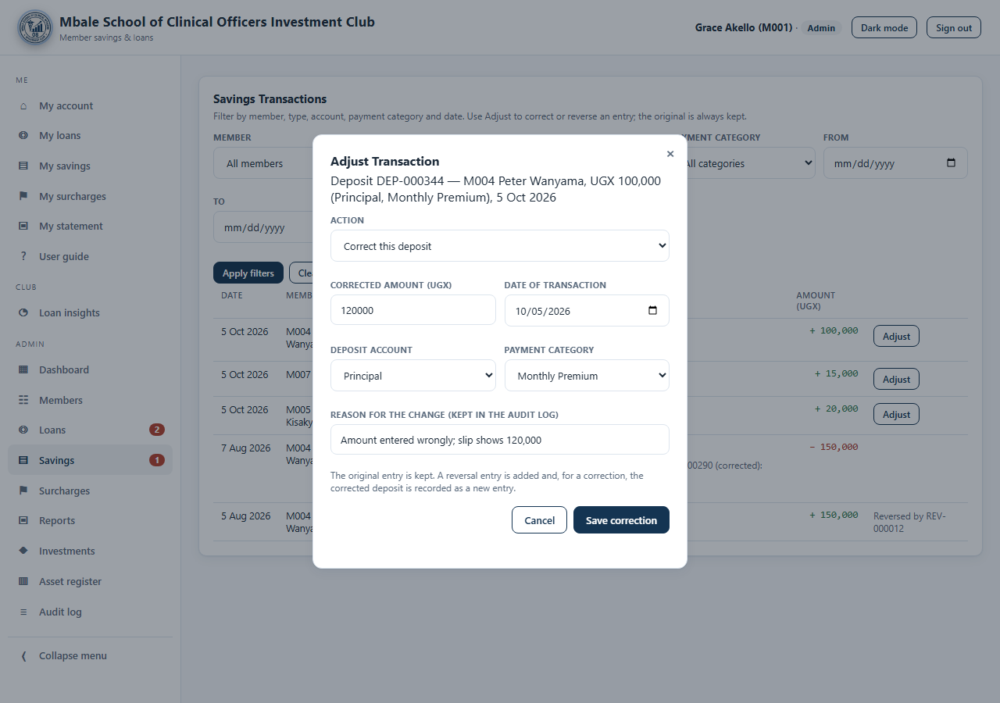

A transaction can only be reversed once. A reversal can't be reversed again, and a reversal that would take an account below zero is refused. Reversed rows show **Reversed by REV-…** in the table. The member is emailed, and the dashboard totals update straight away.

### Approving withdrawals

Withdrawal requests are listed under **Savings → Withdrawal Requests**. Each row shows the member, the account, the amount, the current account balance and the approvals so far.

- Click **Approve (1st)**, then a different admin clicks **Approve (2nd & final)**. The money is taken from the account at the final approval.
- The balance is checked again at approval time. If the account no longer has enough, approval is refused.
- To reject, click **Reject** and enter a reason. The member is emailed the reason.

For **Operations** and **Welfare**, the balance shown is the **club pool** balance.

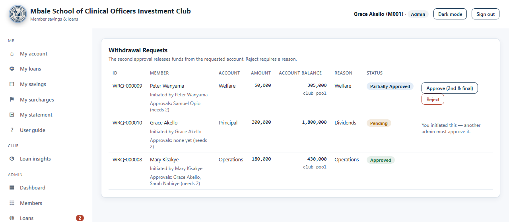

### Proposing and approving loans

**Proposing a loan for a member** (Members → **Propose Loan**):

1. Choose the member. The form switches to the right loan type for their membership type.
2. Enter the amount and term, and tick exactly two Founder Member guarantors.
3. Fill in **Guarantor restriction override** *only* if the member is guaranteeing a running loan and the committee has agreed they may still borrow. Enter the reason, for example the minute number. It is stored with the request and in the audit log.
4. Click **Propose Loan**. This creates a request. It does **not** issue the loan. Because you proposed it, you can't approve it.

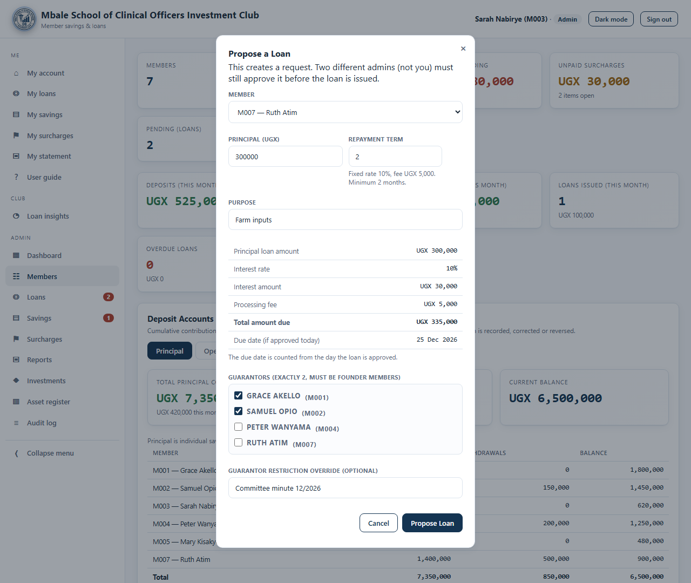

**Approving a loan request** (Loans → **Loan Requests**):

- Each request shows the guarantors and their answers (Pending / Accepted / Declined), any override, and how long it has been waiting. A request older than 3 days is flagged.
- **Both guarantors must accept before any admin can approve.** Until then there is no **Approve** button, and the note under the request shows which guarantors still need to accept. Admins are emailed **"Guarantors all accepted"** when the request is ready for approval.
- Then two different admins approve. The note shows how many approvals it has (for example **Admin approvals: 1 of 2**), and the **second approval issues the loan**.
- A request shown as **Awaiting Guarantors** was approved by both admins under the earlier rules, before its guarantors answered. It is issued automatically when the last guarantor accepts.
- If a guarantor **declines**, the request can't be approved or issued. Reject it with a reason.
- Every rule is checked again when the loan is issued. If something has changed (for example a guarantor's savings fell below 25% of the loan), the loan is not issued. For an **Awaiting Guarantors** request, admins are emailed **"Loan not issued"**: fix the problem and click **Issue loan**, or reject the request.
- **Active Loans** shows each loan's two guarantors, when they consented, and how many guarantor notices have been sent. Every notice is also logged on the **Guarantor Notifications** tab of the spreadsheet.
- **Member loans** show **Within limit** or **Over limit** against 50% of the member's Principal savings. To approve an over-limit loan, enter an **Override Reason**. Soft Loans have no savings limit.
- The due date is counted from the day the loan is issued.
- An override reason given by either approving admin is kept with the request, so the other admin doesn't need to enter it again.

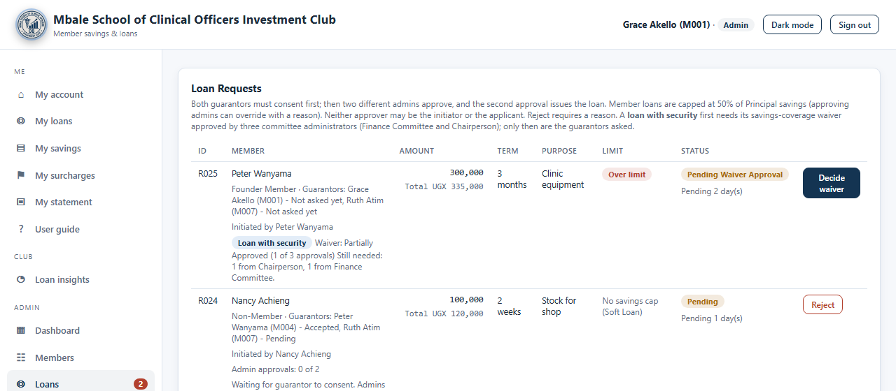

### Deciding waivers for loans with security

A Founder Member who does not meet a savings coverage requirement can ask for a **loan with security** (see Part 1). These requests show in **Loan Requests** with the label **Loan with security** and the status **Pending Waiver Approval**.

- Only administrators with a **Committee role** can decide a waiver. Set it under Members → **Edit** → **Committee role** (**Finance Committee** or **Chairperson**). Every change is kept in the audit log.
- A waiver needs **three different committee administrators**: at least **one Chairperson** and **two Finance Committee** members. Each administrator decides once. Nobody can decide a waiver for their own loan or one they submitted. Once the two Finance Committee approvals are in, only the Chairperson can give the third.
- Click **Decide waiver** to see the requirement not met, the applicant's and guarantors' savings coverage, the security details and documents, and the decisions so far. Then **Approve waiver**, or **Reject waiver** with a reason (the reason is emailed to the applicant). One rejection closes the request.
- The value and ownership of the security are **as declared by the applicant and not verified**. Check them before approving.
- Until the waiver is approved, the loan can't be approved or rejected in the usual way, and the guarantors are not asked. When the third approval is given, the guarantors are emailed for consent and the request becomes **Pending**. It then needs two different admins' approval, as for any loan. An over-limit loan whose cap was waived needs no override reason.
- Only the requirement that failed is waived. If something else changes later (for example the other guarantor's savings fall below 25%), the loan is refused at approval as usual.
- Each decision is kept on the **Waiver Decisions** tab of the spreadsheet, the security and the original savings figures on **Loan Waivers**, and every step in the audit log.

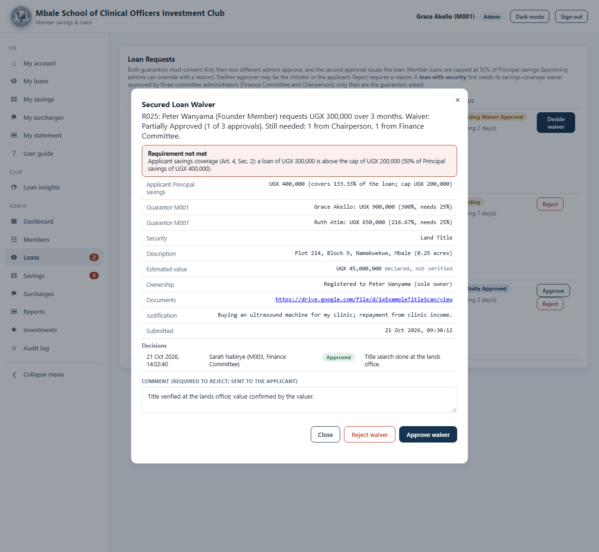

### Recording loan repayments

When a member pays towards a loan:

1. Go to **Loans**. The **Active Loans** panel at the top lists every member's running loan, with overdue loans first. Type a name or loan ID in the filter box to find one quickly.
2. Click **Record Repayment** on the loan.
3. Enter the **Amount received** and the **Date of payment** (it can't be in the future). Add any **Notes**, such as the receipt or mobile money reference.
4. Check the **Breakdown**, then click **Save**.

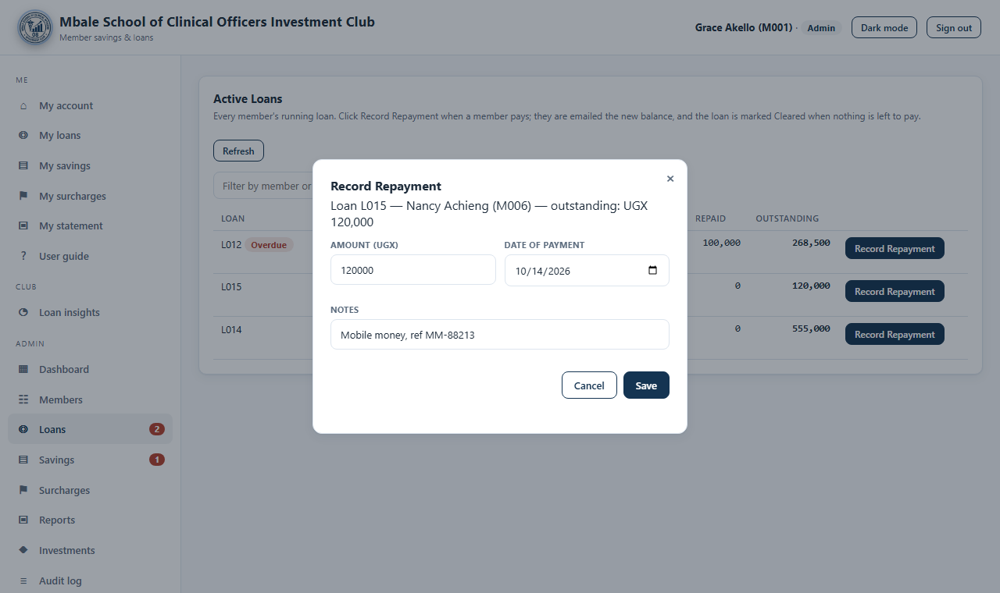

**The breakdown** lists each part of the loan: **Principal**, **Interest**, **Processing fee** and, if one has been charged, the **Overdue surcharge** or **Late penalty**. For each part it shows what was charged, what has been **paid so far**, what is **outstanding before** this payment, how much of **this payment** goes to it, and the **balance after**. It updates as you type. You don't split the payment yourself: the club rule applies it to the processing fee first, then interest, then any surcharge or penalty, then principal. A processing fee that is already paid shows **Already paid** and takes nothing more; loans that have no processing fee show **Not applicable**.

Before saving, the form warns you if:
- the amount is **more than the loan's outstanding balance**. Tick the box to hold the excess as credit on the loan (the club rule), or correct the amount;
- a repayment of the **same amount and date** is already recorded on the loan. Tick the box only if this really is a second payment;
- someone else recorded a repayment on the loan while the form was open. The breakdown refreshes; check it and save again.

The member is emailed the new outstanding balance, and the repayment is recorded in the audit log with your name and how it was split. When nothing is left to pay, the loan is marked **Cleared** and drops off the list. A repayment takes effect straight away; it doesn't need a second approval.

**If a repayment was entered wrongly** (wrong amount, wrong loan, or entered twice), reverse it and then record the correct one:

1. On the **Loans** page, find the repayment in the **Repayments** panel. Each repayment has a reference such as **RPY-000046**. Type a name, loan ID or reference in the filter box to find it.
2. Click **Reverse**, enter the **reason** (required) and click **Reverse**.
3. If needed, record the correct repayment as usual.

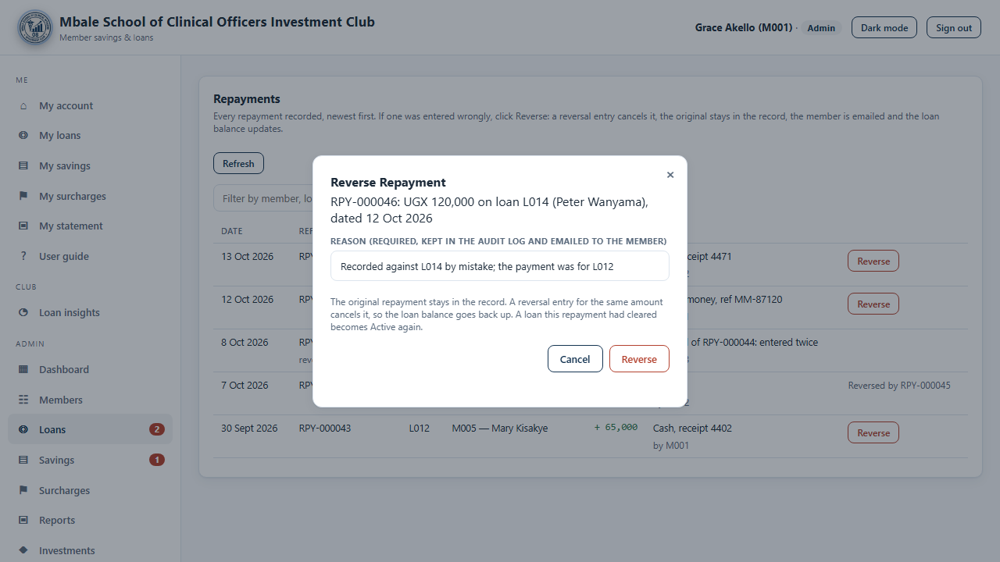

- The original repayment is **never edited or deleted**. A reversal entry for the same amount is added beside it, marked with the reference it reverses, and the original shows **Reversed by RPY-…**.
- The loan's outstanding balance goes back up. If the reversed repayment had cleared the loan, the loan becomes **Active** again and reappears under **Active Loans**.
- The member is emailed, and the reversal is recorded in the audit log with your name and the reason.
- A repayment can be reversed only once, and a reversal can't itself be reversed.
- The reversal is dated the day you make it. Reports for earlier months still show the original payment, and the reversal appears in the month it was made.

### Surcharges (admin)

- **Issue Surcharge** (on the Members page): choose the member, enter the amount and reason.
- Under **Surcharges**, click **Mark Paid** when the member pays.

The 10% overdue surcharge on single-due-date loans is applied **automatically** the day after the due date. You don't need to issue it.

### Updating the terms of use

Admins can change the **Terms of Use** and the **Administrator Confidentiality and Conduct Agreement** in the app:

1. Open **Terms of use** in the menu and click **Edit terms**.
2. Choose the document. The window shows its current version, how many users have accepted it, and every version published so far.
3. Edit the title, the wording of the tickbox and the text. Start the text with an introduction paragraph; then, for each section, a line starting with `## ` for the heading and one line starting with `- ` for each point. Click **Preview** to see it as members will.
4. Describe **what changed**. This is required, and is kept with the version and in the audit log.
5. Tick the box to confirm, and click **Publish new version**.

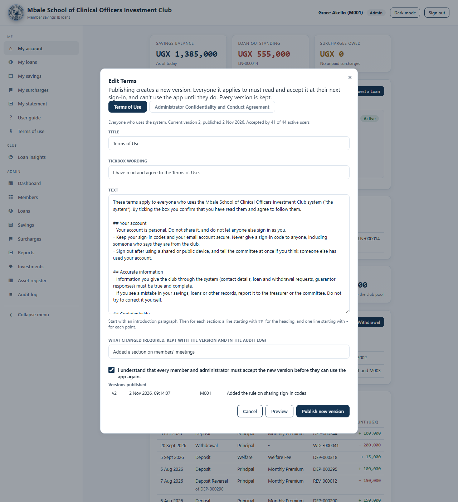

Publishing creates a new version straight away. **Everyone it applies to** (every user for the Terms of Use, every admin for the Administrator Agreement) must read and accept it at their next sign-in, or the next time they do something in the app, and can't continue until they do. That includes you. Earlier versions and everyone's earlier acceptances stay on record on the **Terms Versions** and **Terms Acceptance** tabs.

### Reports and the audit log

- **Reports**: **Download Ledger PDF** (a formatted report) or **Download Ledger CSV** (for a spreadsheet). Both include members, loans, savings transactions with their accounts, and surcharges.
- **Audit log**: every action is listed with its date and exact time (East Africa Time, to the second), the action, the member affected, who did it and the details. This covers contributions, corrections, reversals, withdrawal and loan requests, approvals, rejections, guarantor answers (with decline reasons) and overrides. Entries can't be edited in the app.
  - **Finding an entry**: the newest entries show first, 100 to a page, grouped by day; use **Older** and **Newer** to page through. To find anything in the club's history, use **Search** (an action, a name, words from the details or a reference), **Member** (everything that happened to that member *or* was done by them), **Category** (Savings, Loans, Investments, Assets, Members, Exports, System), the **From** and **To** dates, or **Sensitive actions only**, then click **Search**. The filters combine; **Clear** removes them.
  - **Sensitive actions** have a red edge and a **Sensitive** label: reversals, corrections, overrides, member and terms changes, asset disposals, backups and exports. These are the entries to check first in a review.
  - **Follow a record**: click a member to see their whole history, or a reference (for example a loan request number) to see every step of that record, from request to approval.
  - **Download CSV** downloads everything that matches the current filters, with member names and categories, oldest first. Leave every filter blank to download the whole log. Large logs download in parts and the progress is shown beside the button. Each download is itself recorded in the audit log.

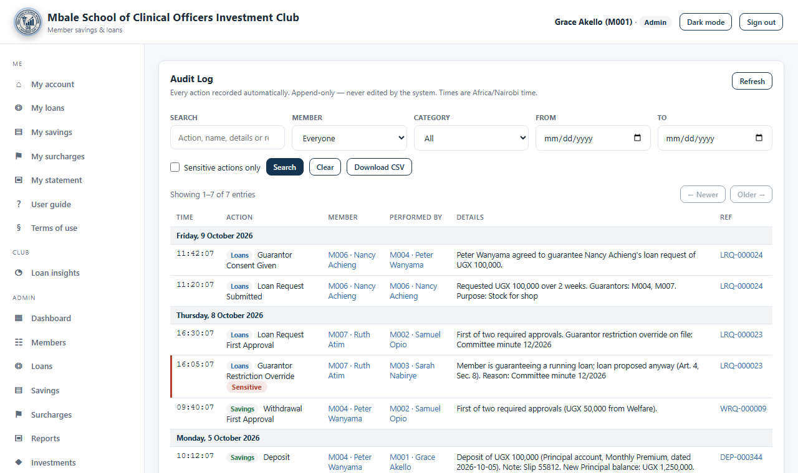

### Loan Insights (admin)

Admins see the same Loan Insights page as Founder Members (see [Loan Insights (Founder Members)](#loan-insights-founder-members)), with three more panels at the bottom:

- **Loan Fund Ledger entries**: cash that comes into or leaves the loan fund outside the normal savings and loans process. See [Loan fund entries](#loan-fund-entries).
- **Loans in this period**: each loan with its member, dates, and how much principal, interest, fee and penalty has been charged and collected.
- **Trace: loan fund cash ledger**: click **Load ledger** to list every movement behind "available loan cash" in date order, with a running balance. It covers Principal deposits and withdrawals, loans paid out, repayments (with how each was split) and approved loan fund entries. The last balance always equals **Available loan cash** at the top of the page. Use it to check any figure.

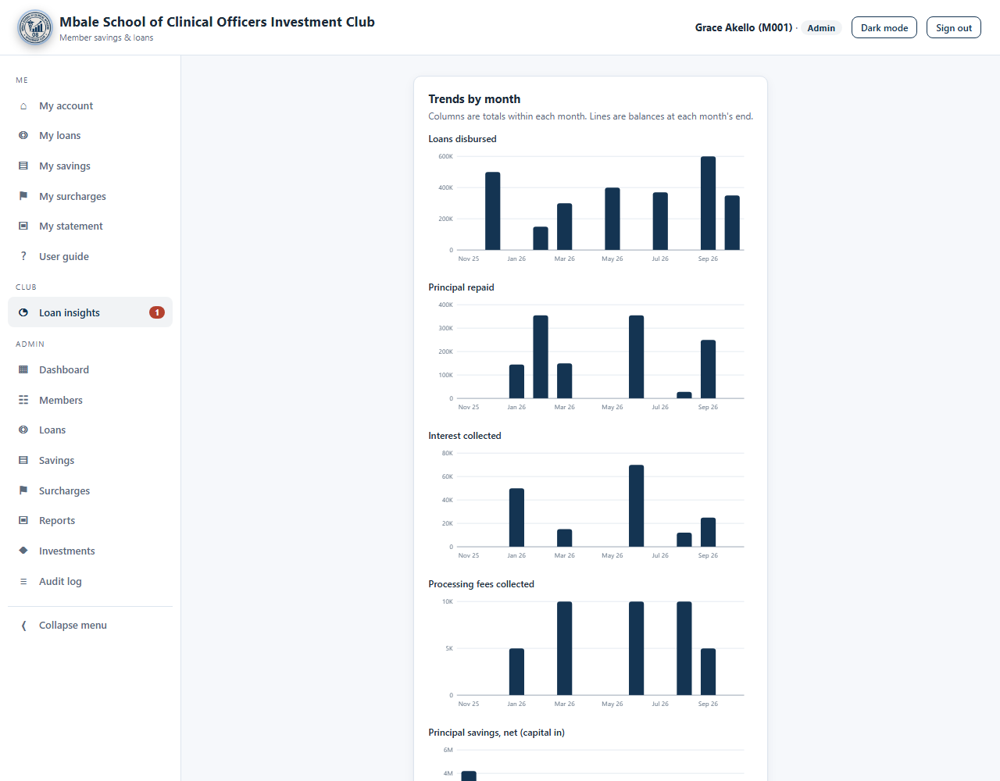

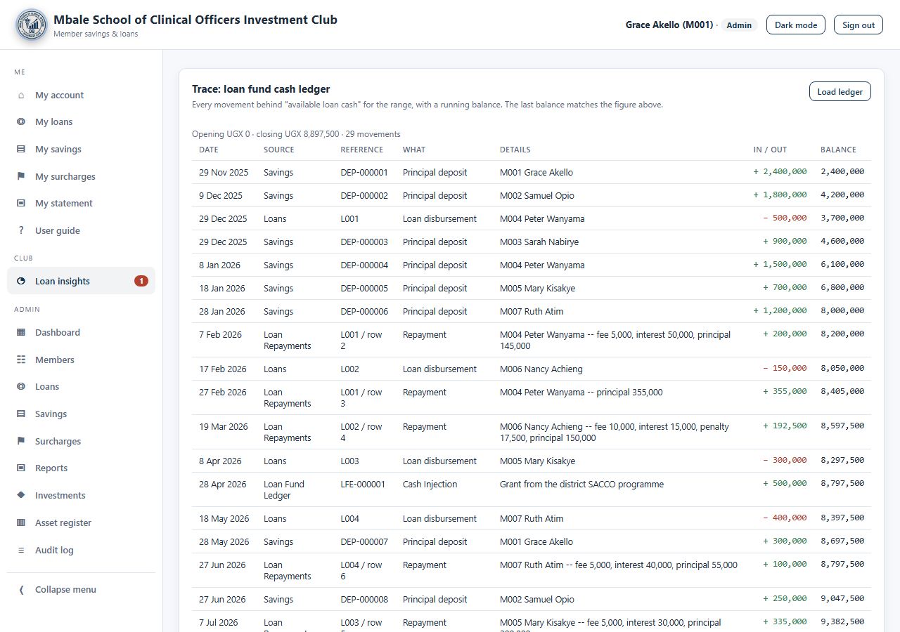

Every figure is worked out from the records each time the page loads. Nothing is typed in as a total, so the page can't fall out of step with the ledgers.

> Before Loan Insights or Investments can be used for the first time, the system administrator must run `setupFinanceSchema()` once in the Apps Script editor. This creates the three tabs these pages use.

### Loan fund entries

Savings, loans and repayments already reach the loan fund through their own pages, so **don't enter them here**. Use a loan fund entry only for other cash:

| Type | Use it for |
|---|---|
| **Cash Injection** | Money added to the loan fund from outside, such as a grant or donation |
| **Other Outflow** | An authorised payment out of the loan fund, such as bank charges |

Transfers between the loan fund and an investment are recorded from the **Investments** page instead (see [Investments](#investments)).

**To propose an entry:**

1. Go to **Loan insights** and click **+ Propose entry** in the **Loan Fund Ledger entries** panel.
2. Choose the **Type** and enter the **Amount** and **Date**.
3. Enter the **Reference**, such as the bank slip or receipt number. A reference can be used only once.
4. Describe the **source or purpose**. This is required.
5. Click **Propose**.

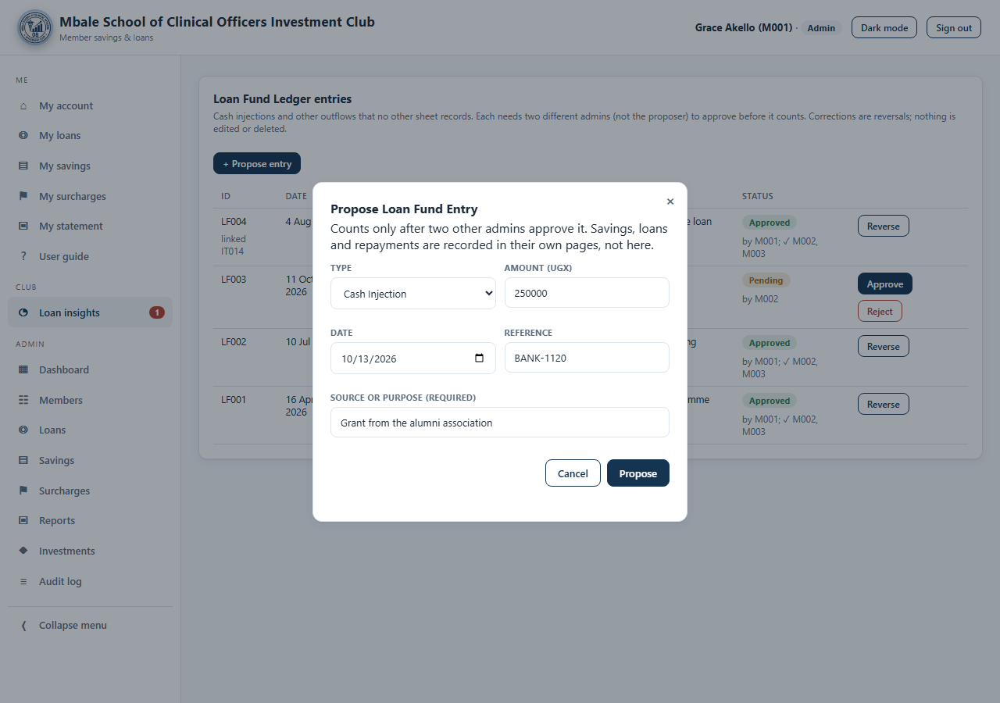

The entry is **Pending** and doesn't count yet. Two other admins must approve it: **Approve**, then **Final approve**. You can't approve an entry you proposed. Any admin can **Reject** a waiting entry with a reason.

- An outflow can't take available loan cash below zero. Outflows still waiting for approval are counted too.
- **To correct an approved entry**, click **Reverse** and give a reason. This proposes a reversal entry, which needs two approvals like any other entry. The original entry is never edited or deleted.
- Every step is recorded in the audit log.

### Investments

**Investments** (admins only) tracks the club's unit trusts, fixed deposits, treasury bills and bonds, and other investments.

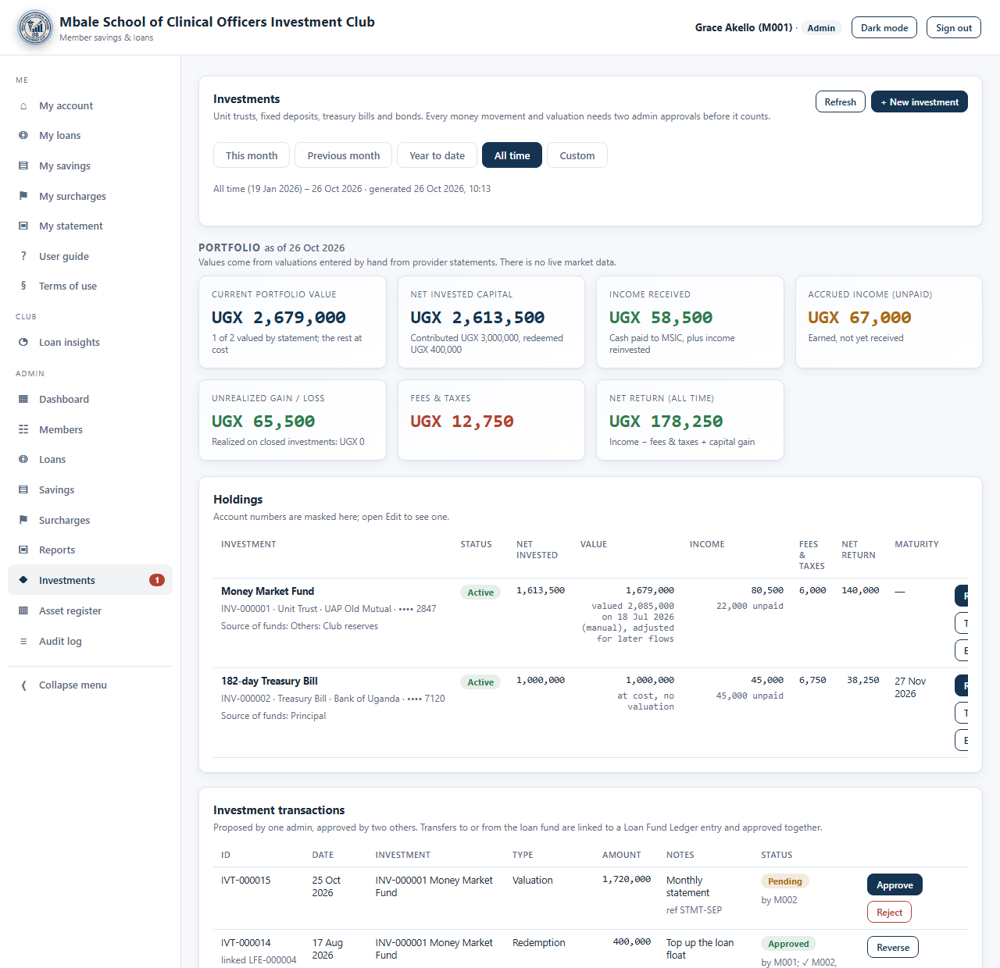

**Adding an investment.** Click **+ New investment** and enter the name, type, provider, start date, maturity date (if any), and the account or reference number. You can also add a link to the certificate or statement. Choose the **Source of funds**: **Principal**, **Operations**, **Welfare**, or **Others** (then say where the money came from, for example a fundraising). If you enter an **Initial amount**, it is proposed as the first transaction. Principal savings are the loan fund's money, so for **Principal** the box **Paid out of the loan fund** is ticked for you: the payment is recorded as a transfer out of the loan fund and lowers *available loan cash*. Untick it only if the money did not come through the loan fund (for example an investment made before the app was used). For **Operations** and **Welfare**, the money comes off that pool's balance once the payment is approved, and money redeemed from the investment goes back into it. You can't invest more than the pool holds (withdrawals and investments awaiting approval are counted), and members' withdrawals from the pool are limited by what is left. The dashboard's Operations and Welfare tabs show the amount **Invested (net)**. For **Others** the source is recorded on the investment only. The **Breakdown** shows the portfolio by source of funds. Once money has been paid into or out of an investment, its source of funds can't be changed.

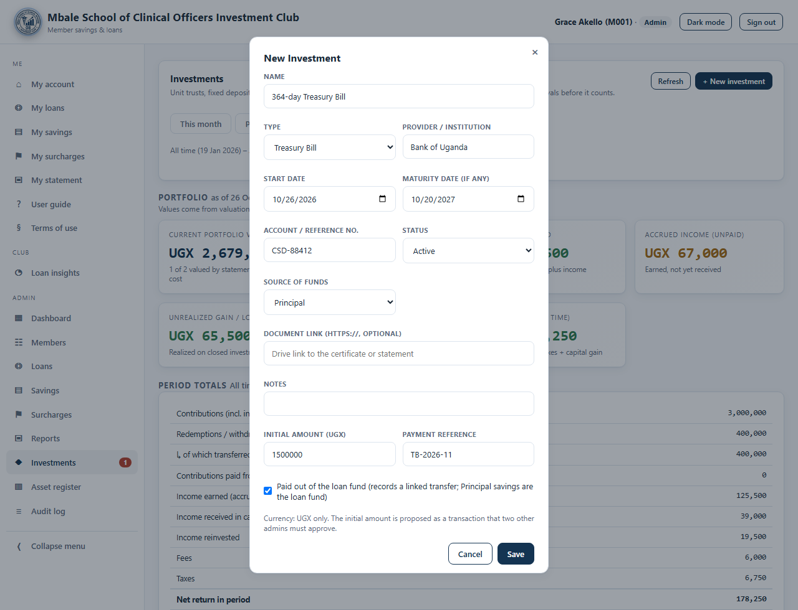 Use **Edit** to change the details later; a reason is required and is kept in the audit log. Account numbers are masked in lists.

**Recording a transaction.** Click **Record** on the investment and choose the type:

| Type | Use it for |
|---|---|
| **Additional Contribution** | More money paid into the investment |
| **Redemption** | Money taken out and paid to the club. This is not income |
| **Income Earned** | A return credited or due, but not yet paid to the club |
| **Income Received** | Income actually paid to the club |
| **Income Reinvested** | Income kept inside the investment instead of being paid out |
| **Fee** / **Tax** | A cost. Say whether it was taken from the investment's balance or paid separately |
| **Valuation** | The value on a given date, copied from the provider's statement |

Like loan fund entries, each transaction needs **two other admins** to approve it before it counts, and a mistake is put right with **Reverse**.

**How the figures work**

- **Income is counted once.** If you record a return as *earned* and later as *received*, the received amount settles the earned amount. It is not added twice.
- **Values are entered by hand.** There is no live market data. Each holding shows the date of its last valuation. If money has moved in or out since then, the value is adjusted for it. An investment with no valuation is shown at what was paid in (**at cost**).
- **Unrealized gain / loss** is the current value less the net amount invested. **Net return** is income, less fees and taxes, plus that gain.
- Fees and taxes are shown separately from income.
- **Maturing in the next 90 days** lists the active investments due to mature soon.

**Moving money between an investment and the loan fund.** Click **Transfer** on the investment and choose the direction:

- **Investment → loan fund**: a redemption from the investment and a matching cash injection into the loan fund.
- **Loan fund → investment**: a matching contribution and outflow. It can't take more than the loan fund's available cash.

Both entries are created together and linked. Approving one approves the other, and reversing one reverses both. A transfer only moves the club's own money, so it is **never counted as income** in either place.

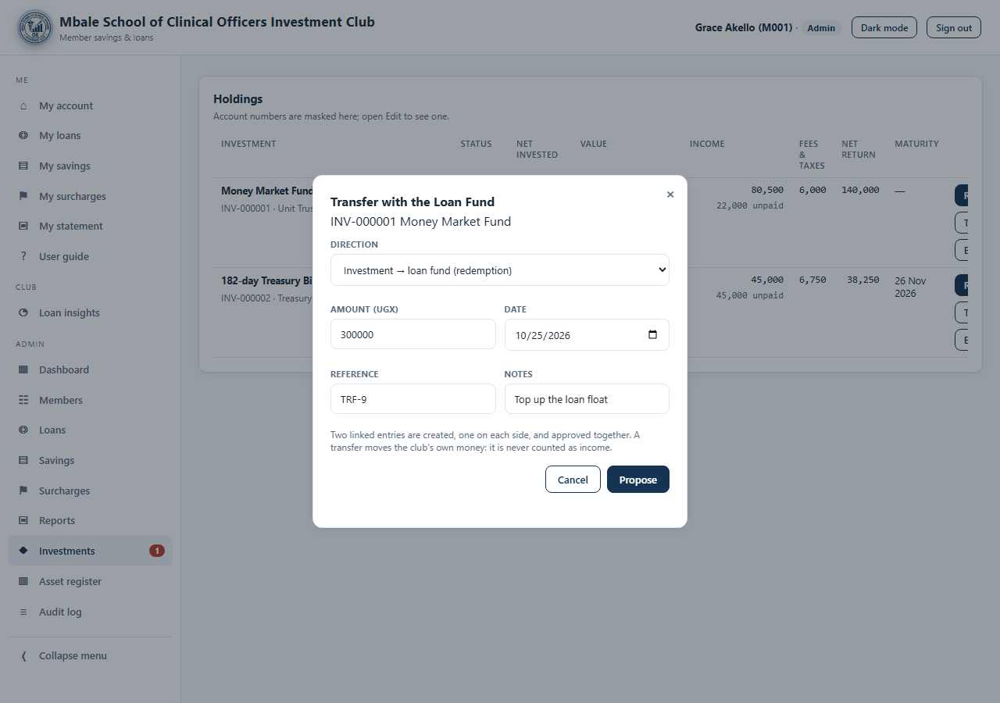

---

### Asset register

**Asset register** (Admin menu) lists the club's own assets: computers, printers, furniture, vehicles, equipment and others. Only administrators can see or change it.

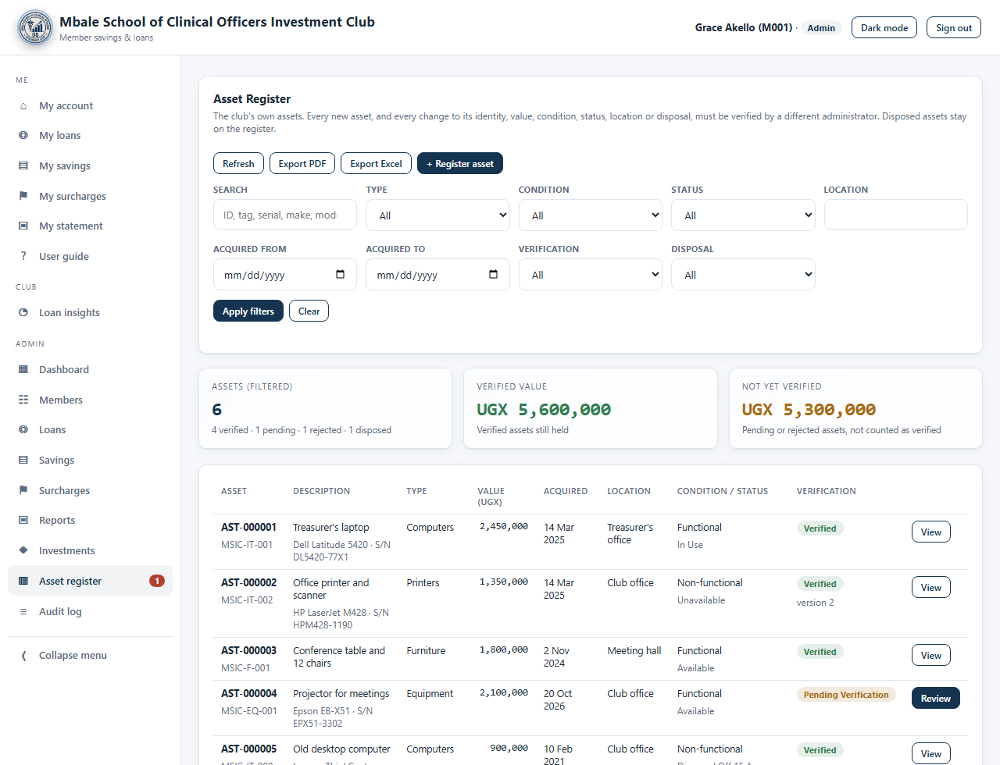

**Registering an asset.** Click **+ Register asset** and enter the type (for **Other**, say what it is), a description, the value in UGX, the date acquired, the condition (**Functional** / **Non-functional**), the status (**Available**, **In Use**, **Unavailable** or **Disposed Off**) and the location. Add the asset tag, make, model and serial number where there are any. Tags and serial numbers must be unique. You can add links to receipts, invoices or photos (for example in Google Drive), one per line, starting with https://.

**Verification.** Every new asset starts as **Pending Verification**. A **different** administrator opens it (**Review**), checks the details and documents, and clicks **Verify**, or **Reject** with a reason. A rejection is emailed to the person who entered the asset; they correct it and save, which sends it for verification again. You can't verify an asset you registered, or a change you made.

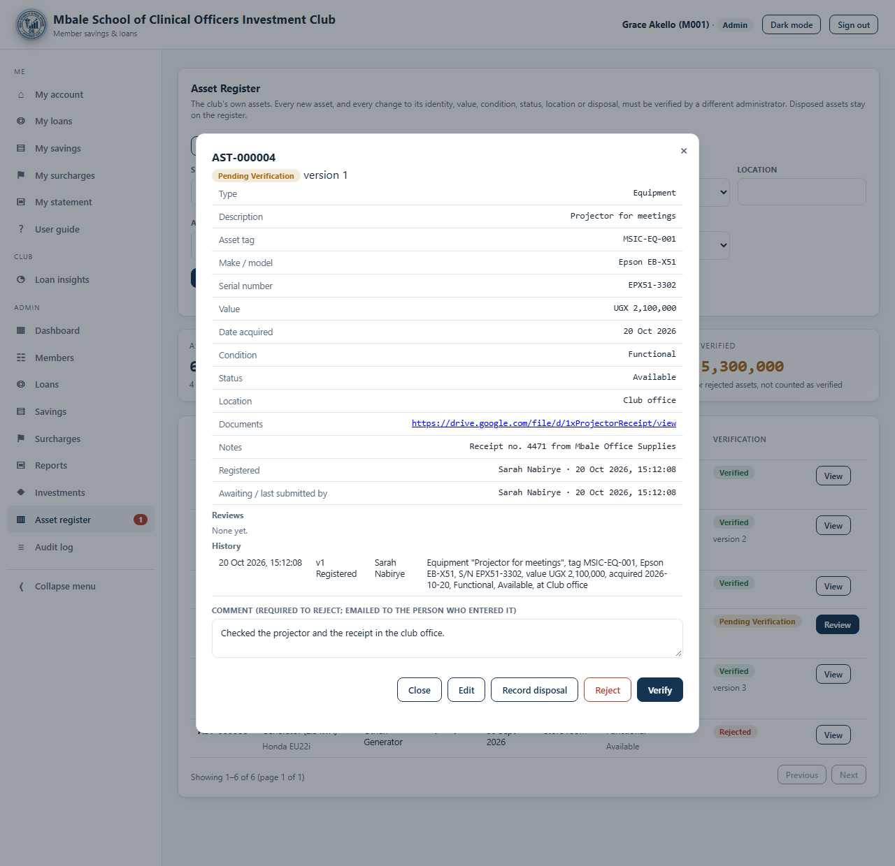

**Changing an asset.** Open it and click **Edit**. A reason is required. Changes to the asset's identity (tag, type, make, model, serial number), value, date acquired, condition, status, location or disposal details send it back to **Pending Verification** as a new version. Corrections to the description, notes or document links don't. Every change is kept in the asset's **History** with the old and new value.

**Disposing of an asset.** Open it and click **Record disposal**. Enter the disposal date, who it went to and their phone number or email. The asset stays on the register, marked **Disposed Off**, and the disposal must be verified by a different administrator. Assets are never deleted.

**Search, filters and exports.** Search by asset ID, tag, serial number, make, model or description, and filter by type, condition, status, location, acquisition dates, verification and disposal. **Export PDF** and **Export Excel** download the register with the same filters. Pending and rejected assets are clearly marked, and only verified assets count towards the **Verified value**. Every export is recorded in the audit log.

## Frequently asked questions

**Why can't I see "My savings"?**
Non-Members don't have savings accounts, so the section is hidden.

**Why can't I see the Request Withdrawal button?**
Withdrawals are open to Founder and Delegate Members. Ask an admin to check your membership type.

**I contributed nothing to Welfare. Can I still withdraw from it?**
Yes. Operations and Welfare are shared club pools. Founder and Delegate Members can request withdrawals up to what the club holds, whatever they contributed.

**Why is my loan limit lower than I expected?**
Only your **Principal** savings count towards the 50% loan limit. Operations and Welfare contributions don't.

**My loan request says "Waiting for guarantor".**
One of your guarantors hasn't responded to their email yet. Ask them to check their inbox and spam folder.

**A guarantor declined. What now?**
That request can't go ahead. Once an admin has rejected it, submit a new request with a different guarantor.

**An entry in my history says "Deposit Reversal".**
An admin cancelled or corrected one of your transactions. The note shows which reference it reverses, and you were emailed the reason.

**Why can't I see Loan insights?**
It is open to Founder Members and admins. Ask an admin to check your membership type.

**Can other members see my loan in Loan Insights?**
No. Founder Members see club totals only. Only admins can see individual loans.

**Why is "Available loan cash" different from the loans outstanding?**
Available loan cash is the money the club holds now. Loans outstanding is money borrowers still owe. The **Fund position** table adds the two together.

**A repayment was recorded wrongly. Can it be fixed?**
Yes. An admin reverses it under **Loans → Repayments** and records the correct one. The member is emailed both times.

**Who do I contact about a mistake?**
The treasurer or any committee admin.
